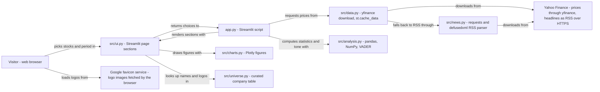

# Stock comparison - Architecture and design rationale

*Last updated: 2026-11-07 · commit 8a9bd36d4*

## 1. Purpose and scope

A Streamlit page for comparing up to eight stocks over a period of the visitor's choice: how they moved, how bumpy the
ride was, how they relate to each other and what recent headlines say. It offers a curated list of 45 large companies
with logos and a sector filter, accepts any other ticker, adds the S&P 500 as an optional benchmark, and scores
headlines with a sentiment method. It is a learning and portfolio project in financial data handling, simple risk
statistics and applied text sentiment.

It is not investment advice or a trading tool; the page footer says so. Prices come from an unofficial source and can be
delayed or incomplete. No model predicts prices. Setup and usage are in the [README](../README.md).

## 2. How this project was built

This project was built with Claude Code (Anthropic's AI coding assistant) in a complementary role. Elliott Fairhall is
the author and owner: the project is debugged, tested and used by him for learning and development, and the design
decisions below are explained so that they can be understood, questioned and learned from. AI assistance does not
replace that work, and nothing in this repository should be read as an unreviewed, machine-only product. The commit
history records the assistant as a co-author on the commits that built and redesigned the page and on the earlier
error-handling work.

## 3. Architecture at a glance

- Server-side network calls go to Yahoo only; the favicon requests come from the visitor's browser.
- Prices and headlines are cached for 15 minutes.

Every control change reruns `app.py`: it downloads (or reads from the 15-minute cache) one price frame for all chosen
tickers, reduces it to closing prices, computes the statistics, and renders the summary table, charts, analysis tabs and
headlines. The server never calls the favicon service; the visitor's browser does.

## 4. Components

| Component   | Responsibility                                                                          | Key files           | Depends on                              |
| ----------- | --------------------------------------------------------------------------------------- | ------------------- | --------------------------------------- |
| Entry point | Page order, empty and error states                                                      | `app.py`            | `src/`                                  |
| Data        | Cached price download; cached headline lookup with fallback                             | `src/data.py`       | yfinance, `src/news.py`                 |
| News        | RSS download, safe XML parsing, relevance filter, de-duplication                        | `src/news.py`       | requests, defusedxml, `src/universe.py` |
| Analysis    | Close prices, rebasing, volatility, drawdown, correlation, VADER with a finance lexicon | `src/analysis.py`   | pandas, NumPy, vaderSentiment           |
| Universe    | 45 companies (ticker, name, sector, domain), logo URLs, monogram fallback               | `src/universe.py`   | pandas                                  |
| Charts      | Price, risk and return, drawdown, rolling volatility, correlation, returns, tone        | `src/charts.py`     | Plotly                                  |
| UI          | Sidebar, summary table, tabs, headlines table, scorer                                   | `src/ui.py`         | Streamlit                               |
| Diagnostics | Manual script to test the live Yahoo connection                                         | `check_yfinance.py` | yfinance                                |
| Tests       | Analysis, news, page, dependency pins against fakes                                     | `tests/`            | pytest, `AppTest`                       |

Behaviour that is not obvious from the names:

- `close_prices()` keeps only tickers that returned data, and the page warns about the rest, so one bad symbol does not
  hide the others.
- `is_relevant()` keeps a headline if the company name appears in its title or summary, or the ticker appears as a whole
  word in the title. Yahoo's feed also returns articles that merely mention a symbol.
- `src/data.get_stock_news()` tries the RSS route first and the older yfinance news endpoint only if RSS returns
  nothing.

## 5. Data and control flow

1. `render_sidebar()` returns tickers (up to eight, typed symbols accepted), a period code, an indexed or price view and
   a benchmark toggle. With no tickers the page shows a prompt and stops.
2. `get_stock_data()` calls `yf.download` once with every ticker (plus `^GSPC` when the benchmark is on), cached for 900
   seconds. Any exception is logged and becomes `None`.
3. `close_prices()` extracts each ticker's `Close` column. If nothing came back, the page shows an error and stops;
   otherwise the S&P 500 column is renamed for display and tickers with no data are listed in a warning.
4. `summary_table()` computes price, one-day change, period return, annualised volatility, worst drawdown and a 60-point
   sparkline. The charts and analysis tabs are built from the same close frame.
5. `get_stock_news()` fetches each symbol's RSS feed, filters, de-duplicates and sorts; `analyze_sentiment()` scores
   titles. The headlines table can be filtered by stock and tone, and a text box scores any typed headline.

State: the Streamlit cache holds the price frame and the headlines for 15 minutes; widget values hold choices. Failure
handling is layered: network errors in the RSS route return an empty list, a malformed feed returns an empty list, a
failed price download shows an error message, and a missing ticker shows a warning.

## 6. Design rationale

### Streamlit for the page, yfinance for prices

- **Why:** the page is controls, tables and charts, which Streamlit builds in Python with no front-end build. yfinance
  needs no API key, so anyone can run the project from the README without signing up for a service.
- **Gave up:** reliability and terms. yfinance reads Yahoo's unofficial endpoints, which can change or rate-limit
  without notice; the README warns that prices can be delayed or incomplete.
- **Alternative not taken:** a keyed provider such as Alpha Vantage or Finnhub, which is more stable but needs a secret
  and has request limits. The `.env.example` file lists those names as possible future providers.
- **Evidence:** README, `.env.example` and `IMPROVEMENTS.md` (`documented`); the key-free reasoning is `inferred`.

### One download call, a 15-minute cache, and a broad catch that returns None

- **Why:** a single `yf.download` for all tickers is one request and returns a frame grouped by ticker. A 900-second
  cache keeps reruns fast and avoids hammering Yahoo while a visitor changes unrelated controls. Returning `None` on any
  failure lets the page show one clear error instead of a stack trace.
- **Gave up:** one bad ticker cannot fail the whole download, but a network failure hides which ticker caused it. A
  broad `except Exception` also hides programming errors in the log.
- **Alternative not taken:** per-ticker downloads, which isolate failures but multiply requests; no cache, which is
  simpler but slower and more likely to be rate-limited.
- **Evidence:** `IMPROVEMENTS.md` describes the logging, empty-frame checks and graceful degradation added to
  `get_stock_data` (`documented`); the cache lifetime is `inferred`. The document is partly out of date (section 8).

### Headlines from Yahoo's RSS feed, parsed with defusedxml, with yfinance news as a fallback

- **Why:** yfinance's news endpoint returns nothing, so headlines come from Yahoo's public RSS feed, which needs no key.
  The feed is untrusted XML, so it is parsed with `defusedxml`, and a test confirms that an entity-expansion document is
  rejected.
- **Gave up:** dependence on an undocumented-for-this-purpose public feed that can change, and headlines are limited to
  what the feed returns.
- **Alternative not taken:** a news API such as NewsAPI.org, which `IMPROVEMENTS.md` lists as an optional next step and
  which would need a key.
- **Evidence:** README, the `src/news.py` module docstring, commit `0da0d9920` and `check_yfinance.py`, whose news check
  treats an empty result as only a warning (`documented`).

### Filter headlines for relevance with a simple rule

- **Why:** the feed includes articles that only mention a symbol. A rule (company name in title or summary, or the
  ticker as a whole word in the title) removes most noise with a few lines of code and is easy to test.
- **Gave up:** misses articles that use a product name or a nickname, and typed tickers outside the 45-company table
  have no name to match, so only the title rule applies.
- **Alternative not taken:** a learned relevance model, or no filtering.
- **Evidence:** commit `0da0d9920` ("filtered for relevance"), the `is_relevant()` docstring and tests (`documented`).

### VADER with a small finance word list for headline tone

- **Why:** VADER is quick, needs no training data and suits short text such as headlines. It is trained on general
  language, so 31 market terms (for example "plunge", "downgrade", "beats") are added to its lexicon so that headlines
  read as a trader would expect. A tone filter, a tone chart and a "score any headline" box let a visitor see how it
  behaves.
- **Gave up:** the weights were set by hand and not validated against labelled headlines; the page calls the result "a
  rough guide". It scores titles only, not summaries.
- **Alternative not taken:** a finance-specific model such as FinBERT, which is more accurate but needs a large download
  and a model runtime.
- **Evidence:** the code comment above `FINANCE_LEXICON` and the caption on the page (`documented`); the weights
  themselves and the FinBERT trade-off are `inferred`.

### Textbook risk statistics, written out in short pure functions

- **Why:** volatility (standard deviation of daily returns scaled by the square root of 252), maximum drawdown, rolling
  volatility, correlation of daily returns and an indexed-to-100 view are standard and easy to check by hand. Each
  function takes a Series or DataFrame and has a test against the formula.
- **Gave up:** no beta, Sharpe ratio or dividend-adjusted return discussion; all figures use whatever Yahoo's `Close`
  holds. Stocks that begin trading at different dates are compared over their own available history.
- **Alternative not taken:** a quantitative finance library, which would hide the formulae that the project is meant to
  show.
- **Evidence:** `src/analysis.py` and its tests (`documented`).

### A curated 45-company list with logos, and free entry for anything else

- **Why:** a searchable list with sector filter and logos makes the page usable without knowing tickers. Logos are site
  icons that the browser fetches from Google's favicon service, so there are no image files to store or licence; unknown
  tickers get a generated initials icon so a table never shows a broken image. Typing any other symbol still works.
- **Gave up:** the list is hand-maintained and static, and each logo request tells Google which company domains a
  visitor is viewing. Typed tickers have no name or sector.
- **Alternative not taken:** a full exchange listing (large, needs a data source) or bundled logos.
- **Evidence:** README and commit `0da0d9920` (`documented`).

### Module split: data, news, analysis, universe, charts, UI

- **Why:** the statistics in `src/analysis.py` import no Streamlit and so are tested without a page; network access is
  confined to `src/data.py` and `src/news.py`, which tests patch. It keeps `app.py` at 72 lines.
- **Gave up:** `src/data.py` still contains the older yfinance news code (`_yfinance_news`) for the fallback, with its
  own logging setup.
- **Alternative not taken:** one script, which the earlier version resembled.
- **Evidence:** commits `90b5e1795` (added `src/__init__.py` to fix module resolution) and `0da0d9920` (`documented`).

### Offline tests against fake Yahoo responses, and a manual live check

- **Why:** a test suite that calls Yahoo would be slow and flaky. The fixtures patch `yf.download`, `yf.Ticker` and
  `requests.get`, so the suite is deterministic. The live connection is checked by hand with `check_yfinance.py`,
  renamed so that pytest never collects it.
- **Gave up:** the fakes always return `(ticker, field)` columns; whether the real service does so for a single ticker
  is not tested.
- **Alternative not taken:** recorded real responses, or running live checks in the suite.
- **Evidence:** the `tests/conftest.py` docstring and commit `0da0d9920` (`documented`).

### Native theme, dependency floors without caps, Pillow guard, hosting

- **Why:** the same approach as the sibling projects (theme in `.streamlit/config.toml`, small stylesheet, floors set to
  tested versions, a test guarding the Pillow pin). The README badge links a Streamlit Community Cloud address.
- **Gave up:** bespoke styling, and protection from breaking upgrades beyond the tests; hosting settings are outside the
  repository.
- **Alternative not taken:** a lock file; a container host.
- **Evidence:** commits `0da0d9920`, `f3b4a2b89`, `1d92103f9` and the README badge (`documented`).

## 7. Quality and testing

Counts are from reading the files; the suite was not run for this document. Commit `0da0d9920` reports 58 offline tests
passing on Python 3.11 and 3.13; the functions below total 52, with the rest coming from parametrised cases.

- `tests/test_stock_analysis.py` (17 functions): rebasing, drawdown, volatility, correlation, returns, summary table,
  `close_prices`, headline sentiment sign, blank headlines, universe integrity and logo URLs.
- `tests/test_news.py` (16): RSS parsing (including garbage and an entity bomb), source names, relevance rules,
  de-duplication and sorting, request failure, fallback to yfinance, finance-term scoring, and the headlines table with
  tone and stock filters.
- `tests/test_stock_app.py` (9): default render, benchmark toggle, typed ticker, sector filter, unknown ticker warning,
  empty selection, period and view controls, the headline scorer.
- `tests/test_app_smoke_stock.py` (5) and `tests/test_pillow_security_stock.py` (5, parametrised).

Not tested: any real Yahoo response, the single-ticker download shape, `src/charts.py` directly (only through page
renders), the favicon service, the broad-exception branch in `get_stock_data`, and `check_yfinance.py` (a manual script
whose own functions are named `test_*`). Sentiment weights are unvalidated against labelled data.

## 8. Constraints, limitations and known gaps

- Prices and headlines come from unofficial Yahoo sources and can fail, lag or change shape.
- `IMPROVEMENTS.md` is out of date. It describes `validate_environment()` in `app.py` and a `NEWS_API` variable; commit
  `90b5e1795` removed the unused variable, no such function exists now, and the script it names `test_yfinance.py` is
  now `check_yfinance.py` (whose own docstring still uses the old name). Its example output shows the yfinance news
  check passing, which conflicts with the README.
- `python-dotenv` is declared and `load_dotenv()` runs, but no code reads an environment variable, and `.env.example`
  lists keys for services the project does not use.
- Single-ticker downloads without the benchmark depend on yfinance returning grouped columns (`TODO: verify`).
- Statistics use Yahoo's `Close` values with no dividend treatment and no data-quality checks beyond dropping empty
  rows.
- The rate-limiting decorator proposed in `IMPROVEMENTS.md` was never added; the 15-minute cache is the only throttle.
- `src/data.py` and `app.py` both call `logging.basicConfig`.
- The hosted deployment's settings are not in the repository (`TODO: verify`).

## 9. Running and extending

See the [README](../README.md) for setup, running and testing, and run `python check_yfinance.py` by hand to test the
live connection. To add a statistic, write a pure function in `src/analysis.py` with a test, then a figure in
`src/charts.py` and a call in `src/ui.py`. To add companies, extend `_COMPANIES` in `src/universe.py` (ticker, name,
sector, website domain); the universe tests check for unique tickers and known sectors.

## 10. Rationale (confirmed by the owner)

Confirmed by Elliott Fairhall on 2026-11-07. This reasoning was first reconstructed from the code and commit history;
the owner has since agreed it is correct, so it is now the stated rationale rather than an inference.

- yfinance was chosen mainly to avoid API keys for a public portfolio project.
- The 900-second cache lifetime was a judgement about politeness to Yahoo and responsiveness, not a measured value.
- The 31 finance terms and their weights were picked by hand for plausible headlines, without a labelled benchmark.
- The 45 companies were chosen as a readable spread across sectors rather than by index membership or market value.
- Sending logo requests from the visitor's browser to Google was accepted as the cheapest way to show logos.
